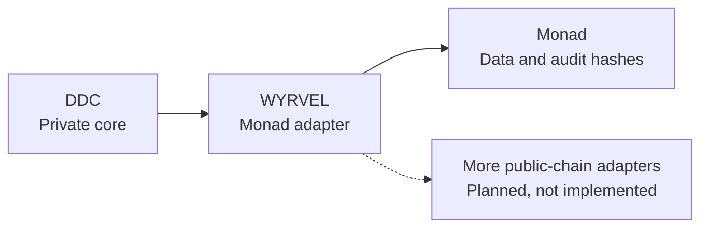
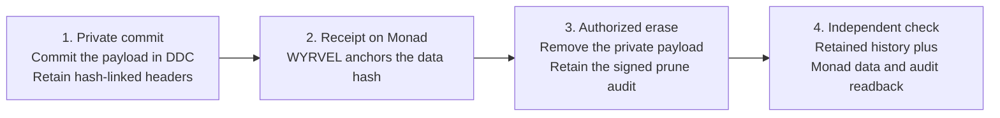
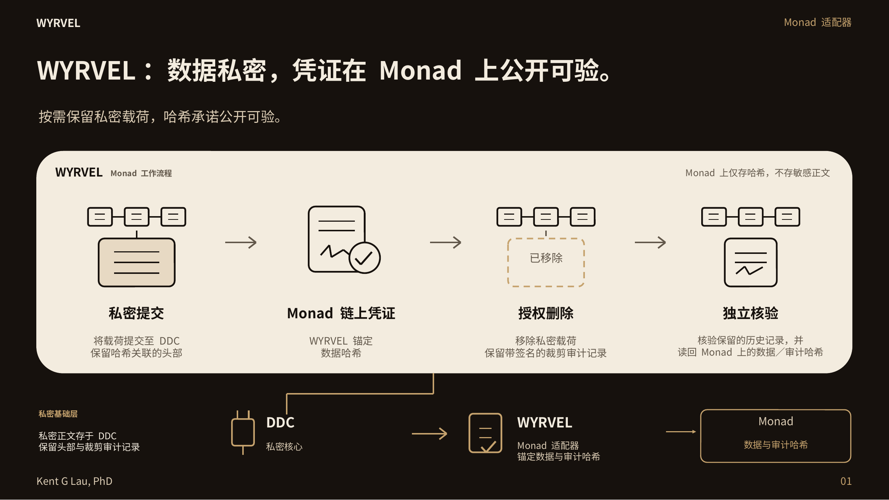
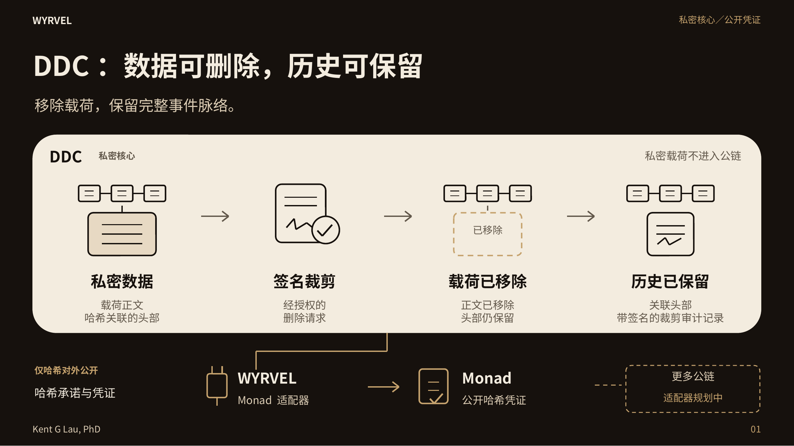

# WYRVEL

Pin a hash. Keep the data private. Erase it. Check that it is gone.

WYRVEL is the Monad adapter for DDC, a private core that can delete authorized payloads while retaining hash-linked headers and a signed prune audit. WYRVEL anchors data and audit hashes on Monad so those commitments can be checked independently. Only hashes go to Monad, never sensitive payload bodies. Further public-chain adapters are planned and are not implemented.


**WYRVEL: private data. Public receipts on Monad.**

Selective private-payload retention. Publicly checkable commitments.

This repository is the Monad Blitz Guangzhou demo (21 Nov 2026). The payload stays in a store the team controls. Monad testnet (chain id 10143) receives only a 32-byte keccak256 pin under a record id. The seal contract stores that hash, a timestamp, and the pinner, emits `Committed`, and does not keep the payload. Erase removes the private copy. Check is a separate view: read the seal, then try to recover the payload.

The same keccak256 of the UTF-8 payload is used in the contract tests, the store, and the end-to-end script.

## Architecture

DDC is the private core. WYRVEL is the Monad adapter. Monad holds hash commitments only, with independent readback.



- **DDC** stores private payload bodies and retains hash-linked headers plus a signed prune audit after an authorized erase.
- **WYRVEL** anchors data hashes and audit hashes on Monad.
- **Monad** records those hash commitments so a second party can read them back independently. It does not receive sensitive payload bodies.
- **Further adapters** to other public chains are planned. They are not implemented.

| Marker | Meaning |
| --- | --- |
|  | Private commit |
|  | Data-hash receipt on Monad |
|  | Authorized erase of the private payload |
|  | Independent check |
|  | DDC private core |
|  | WYRVEL Monad adapter |
|  | Monad hash commitments |
|  | Further adapters, planned and not implemented |

## Workflow



Authorized erase refers to the private payload in DDC. It does not delete records on Monad, and it does not erase copies held elsewhere.

## DDC: deletable data, retained history

Remove the payload. Preserve the chain of events. Private payloads never enter a public chain.


### 简体中文图





## Local demo hardware

This local demo was run on a regular 16 GB laptop, not a server. That is only evidence that this demo can run on an ordinary machine. It is not a recommended minimum, a production specification, or a benchmark, and it is not a guarantee that every laptop will work.

**Observed on this demo host**

- Host memory: 15.25 GiB (a typical laptop marketed as 16 GB).
- Workload: a full single-node Monad Solonet — consensus, execution, and RPC — plus the local WYRVEL and DDC demo.
- Solonet Docker cgroup memory: about 1.67 GiB. This figure does **not** include a separate 4 GiB hugepage reservation on the host. Do not treat 1.67 GiB as Solonet’s total memory use.
- TrieDB: configured at a fixed 6 GiB. This is a configured database size. Do not add it to the cgroup figure as if it were proven additional RAM.

**What you need in order to try a similar local demo**

- A Linux host with Docker.
- Hugepages support, and enough free host memory for a multi-GiB hugepage reservation in addition to ordinary container memory.
- Clear disk headroom. The TrieDB alone is configured at 6 GiB, before container images, chain data, and logs.
- Avoid heavy concurrent applications while the demo is running.

This demo host was documented on 2026-10-26 as Kubuntu (Ubuntu 26.04.1 LTS). That operating-system string was not re-verified when this note was prepared on 2026-11-21. CPU model and storage model or capacity are omitted pending verification.

Monad’s public hash commitments can be read back independently. Running a local Solonet node does not mean WYRVEL or DDC inherit Monad consensus or security properties.

## Quick start

Foundry v1.8 or newer from the official Foundry release (this repo sets `network = "monad"`). Node.js 22.

```bash
git submodule update --init --recursive
forge test
npm install --prefix store
npm install --prefix web
./scripts/e2e.sh --local
./scripts/dev.sh
```

`./scripts/dev.sh` starts Anvil with Monad execution, deploys the seal, starts the store, and opens the Judge Tour at <http://127.0.0.1:5173>. EN / 中文 switches the tour copy and is remembered in the browser. Hashes, record ids, and the name WYRVEL stay as they are.

Phone and desktop screenshots of every tab are in `screenshots/`.

## Demo walkthrough

Use one browser for the operator and the Check tab as the second-party view.

1. **Overview.** The tour is Commit, Erase, then Check.
2. **Commit.** Paste a short payload. The page shows the record id, the keccak256 hash, the pin time, and the transaction hash. On Monad testnet that hash links to [MonadVision](https://testnet.monadvision.com) and [Monadscan](https://testnet.monadscan.com). If the chain cannot be reached, the page shows the error and does not invent a transaction.
3. **Erase.** Remove the private copy for that record id. This does not send a Monad transaction.
4. **Check.** Read the seal from the chain. Before erase, the payload comes back and the hash matches. After erase, the same seal is still there and the payload is not returned.
5. **Why Monad.** Finality, room for many small pins, and explorers a checker can open.
6. **E2E.** One tab per script step. Each tab explains the step and can run it.

## End to end

```bash
./scripts/e2e.sh            # verbose menu
./scripts/e2e.sh --local    # anvil --network monad; the script starts and stops Anvil
./scripts/e2e.sh --ci       # official Monad testnet
./scripts/e2e.sh --step 3   # one step, against the RPC and store already running
```

`--local` runs all six steps: deploy the seal, commit a payload and pin its hash, verify the payload matches the seal, erase the private copy, verify the payload is unrecoverable, verify the seal is unchanged.

`--ci` uses `https://testnet-rpc.monad.xyz` and falls back to `https://rpc-testnet.monadinfra.com`. It reads `PRIVATE_KEY` from the environment. If `PRIVATE_KEY` is unset, it prints a skip message and exits 0. If `PRIVATE_KEY` is set, a passing run prints `WYRVEL e2e ci passed` only after all six steps have produced a contract, a transaction, and an unchanged seal. A failed step exits non-zero. No key is committed. Copy `.env.example` to `.env` locally and leave `.env` out of git. `.secrets/` is ignored as well.

```bash
export PRIVATE_KEY=...          # testnet account with faucet MON
export WYRVEL_CONTRACT=0x...    # optional, reuse a seal instead of deploying
./scripts/e2e.sh --ci
```

Faucet: <https://faucet.monad.xyz>

## Why Monad

Monad is the first public settlement layer for these pins because a checker can treat the seal as final quickly, because the pins are small, and because the ledger is public.

- **Sub-second L1 finality.** Official MonadBFT figures are 300 ms blocks, with a September 2026 mainnet mean of 302 ms. Speculative finality is one slot. Full finality is two slots, about 600 ms. Official docs say a finalized block cannot be reorged.
- **Cheap capacity for many small pins.** The adapter writes a 32-byte commitment and an event, not a payload. At the official minimum base fee of 100 MON-gwei and no priority fee, a typical 200,000-gas call costs 0.02 MON. Design capacity is 10,000+ transactions per second, with a 150M gas block budget. The hackathon uses testnet MON. The product point is the settlement layer, not the hack-day gas bill.
- **A seal a second party can check.** The checker reads the transaction on the official testnet explorers: <https://testnet.monadvision.com> and <https://testnet.monadscan.com>. Chain id 10143.

Further reading: [Why Monad](https://docs.monad.xyz/introduction/why-monad), [MonadBFT](https://docs.monad.xyz/monad-arch/consensus/monad-bft), [gas pricing](https://docs.monad.xyz/developer-essentials/gas-pricing), [historical data](https://docs.monad.xyz/developer-essentials/historical-data).

## Contract

`src/WyrvelSeal.sol` accepts `commit(recordId, commitment)`. A second commit for the same record id reverts. There is no payload argument and no function that rewrites a seal.

```bash
export PRIVATE_KEY=...
forge script script/Deploy.s.sol:Deploy \
  --rpc-url https://testnet-rpc.monad.xyz \
  --broadcast
```

`script/Deploy.s.sol` reads `PRIVATE_KEY` from the environment.

## Store

The store listens on port 8787.

| Call | Effect |
| --- | --- |
| `POST /v1/records` | Store the payload and pin keccak256. Returns the record id and the transaction hash. |
| `GET /v1/records/:id` | Return the payload, or 410 when it is gone. |
| `POST /v1/records/:id/erase` | Remove the private copy. Does not send a transaction. |
| `GET /v1/check/:id` | Read the seal from Monad and report whether the payload came back. |
| `POST /v1/e2e/steps/1` … `6` | Run one end-to-end step and return the log. |

## Deploy the seal, then the tour

Run this on the machine that holds the testnet signing key. The command reads `PRIVATE_KEY` from the environment, checks the signer, estimates gas, and only then broadcasts. It does not print the key.

The funded testnet account for this demo is `0xD3Cea1317b62cB5C0CDe7e8a98cD80bBA2DC671e`.

```bash
npm ci --prefix store
export PRIVATE_KEY            # set on this machine; do not write it into the repo
export WYRVEL_GATE_PASSWORD   # set on this machine; the HTTP username is kent
npm run deploy-seal --prefix store
```

Erase removes the copy in the team store only. The Monad seal stays. WYRVEL does not delete data held anywhere else.

The Fly app is `wyrvel-blitz`, region `sin`, machine `shared-cpu-1x` with 512 MB. Record files live on a volume mounted at `/data`. Create that volume before the first deploy or the machine will not keep commits across restarts. The image runs with `NODE_ENV=production` and will not boot until `WYRVEL_GATE_PASSWORD` is set. The username is `kent`.

```bash
fly apps create wyrvel-blitz
fly volumes create wyrvel_data --region sin --size 1 --app wyrvel-blitz
fly secrets set --app wyrvel-blitz \
  PRIVATE_KEY="$PRIVATE_KEY" \
  WYRVEL_GATE_PASSWORD="$WYRVEL_GATE_PASSWORD" \
  WYRVEL_CONTRACT=0x... \
  RPC_URL=https://testnet-rpc.monad.xyz
fly deploy --app wyrvel-blitz --region sin
```

The store asks the node for the pending nonce and then assigns the next nonce itself, so two pins from one process do not reuse a nonce. A failed send reloads the pending nonce before the next attempt.

## Private chain

The Chain tab is a separate proof of concept. It does not change the Monad seal, the contract ABI, or the files already in the team vault.

It is block-body pruning on a leader-ordered chain: one leader process and two replica processes. Headers stay hash-linked. An authorized prune removes the active body file on those processes. It is not chameleon-hash redaction, not encryption-key destruction, and not a proof that every copy is gone. Backups and operator snapshots are outside the claim. Removing an active body is not a forensic overwrite guarantee. The three processes are not BFT. On one machine they are one failure domain.

New files live only under `/data/chain/`. Existing `/data/index.json` and `/data/payloads` are not migrated and must not be deleted.

Measured on this build: the store process is about 50 MB proportional, and the three chain processes add about 130 MB proportional. `fly.toml` sets `WYRVEL_CHAIN=1` so they start on the existing 512 MB machine. Rollback is a redeploy with that variable removed or set to `0`. Leave the volume in place. Do not run `fly volumes destroy`.

```bash
./scripts/pchain-e2e.sh
./scripts/pchain-e2e.sh --ci
```

## Note

This is a hackathon prototype: a hash pin, a real private erase, and a second-party check.
